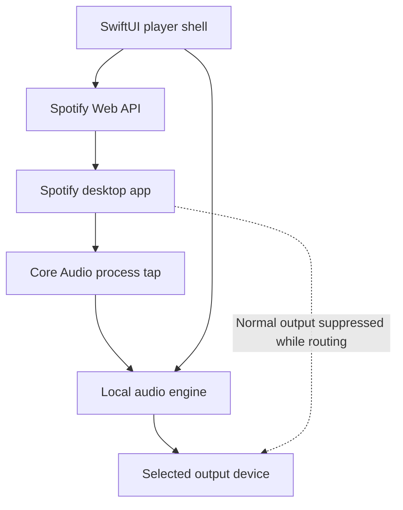

# Player

Implementation status: **installed personal-use app (0.4; Audio Bridge loaded and live-tested)**. The native player,
Spotify PKCE login and Keychain storage, playback controls, now-playing artwork,
seek, explicit Spotify-device selection, private audio routing, local volume,
MCP diagnostics/control, playlist-link playback, and opt-in per-track WAV
debug recording are implemented. The initial isolation, muting and
quit/crash recovery gate passed on this Mac with wired headphones. The broader
hardware, latency and endurance acceptance checks remain open; see
[VALIDATION.md](VALIDATION.md).

## Generic Audio Bridge endpoint

The default path is now a standard Core Audio virtual endpoint, **Audio Bridge**.
Any audio application with an output selector can send to it; any Core Audio
input client can read its loopback. The driver has no Spotify, recording,
network, headphone, or UI dependency.

```text
Application → Audio Bridge output → Audio Bridge input → raw Float32 WAV
                                                      ↘ optional monitor → hardware
```

The small HAL plug-in exposes stable UID `se.lbsa71.AudioBridge.endpoint.v1`.
It supports 1, 2, 4, 6, 8, 16 or 32 channels at 44.1, 48, 88.2, 96, 176.4 or
192 kHz. Its standard stream-format properties select the format; HAL persists
that choice. The first forwarding/recording service supports **stereo**. Wider
clients can use the endpoint independently; future service extensions need no
new driver interface. It is a user-space HAL plug-in, not a kernel extension.

`AudioBridge.app` is a separate per-user LaunchAgent. It captures the endpoint,
records WAVs, and optionally forwards to a selected physical stereo output.
Monitoring has its own volume, bounded queue and clock-drift correction; WAV
samples are copied before those operations. Unplugging the listening device
stops monitoring while capture and WAV recording continue. A changed or stopped
monitoring engine also stops listening rather than silently switching outputs;
choose Listen again to reconnect the desired hardware. The service can run
without Player or Spotify, with generic file labels supplied through local RPC.
Player supplies optional track labels and a ten-second renewable metadata lease.
If Player quits or metadata stops arriving, that recording is finalized to avoid
mislabeling; generic recordings without a lease continue independently.

Install the driver once, then update the apps separately:

```sh
./scripts/test-driver.sh
./scripts/package-driver.sh
open build/AudioBridge-1.0.0.pkg   # administrator authorization required
./scripts/install-bridge-agent.sh
./scripts/install-app.sh
```

The package writes only `/Library/Audio/Plug-Ins/HAL/AudioBridge.driver` and
restarts Core Audio, briefly interrupting Mac audio. If macOS prevents the
restart, reboot to load the endpoint. No SIP changes are required. App/agent
install scripts never reinstall the driver. Future OS compatibility fixes or
changes to the endpoint itself may still require a driver update; a literal
“never reinstall” guarantee is not possible.

Player uses Audio Bridge for capture. The main window shows the capture source,
recording file/folder, and listening status separately. Use **Record playlist**
or **Stop recording** for WAVs, and **Enable audio** if setup is inactive. The
legacy process-tap path is no longer offered in the UI. macOS asks AudioBridge for Microphone
permission because this is an input device; the code opens only the virtual
endpoint, never the physical microphone. Recording is always opt-in and off
after service restart. Capture and monitoring preferences survive restarts.

**Use for Mac audio** explicitly makes Audio Bridge the regular default output.
All apps following that default are included, not only Spotify. Default input
and system-alert output are unchanged. Spotify's Web API does not select a
local Core Audio device. Use **Restore Mac output** or **Stop capture** to
restore the previous available physical output. If the saved output is absent,
choose one in macOS Sound settings. With monitoring off, endpoint audio is
recordable but inaudible. The LaunchAgent restarts a crashed service; sound may
be interrupted during recovery. It does not resume recording automatically.

For driver removal, restore a physical default output first, stop capture,
then unload the agent with
`launchctl bootout gui/$(id -u)/se.lbsa71.AudioBridge.agent`.
Move its plist from `~/Library/LaunchAgents/` and its app from `~/Applications/`
to Trash. An administrator can move only `AudioBridge.driver` out of the HAL
folder and restart the Mac; leave other vendors' drivers alone. Recordings are
independent files and are retained.

## Build and install

Requires macOS 14.4+, Xcode command-line tools, and Spotify desktop.

```sh
swift test
./scripts/install-app.sh
```

The installer builds a release app, signs it locally, installs it in
`~/Applications/Player.app`, and opens it. To build without installing, use
`./scripts/build-app.sh`. Set `PLAYER_INSTALL_DIR` to choose another installation
directory. Set `PLAYER_SIGNING_IDENTITY` to an available Developer ID identity
for a distribution-signed build; notarization is a separate release step. The
default ad-hoc signature is intended only for local testing.

1. Open Spotify, sign in and play a track **on this Mac**.
2. In Player’s connection settings, enter your Spotify developer application's
   public client ID. Register `http://127.0.0.1:43871/callback` as its redirect
   URI and select **Web API**. No client secret or Web Playback SDK is needed.
3. Click **Connect Spotify** and complete browser sign-in (including **Continue
   with Google** if that is how you use Spotify). Approve playback-state and
   playback-control access. Refresh credentials are stored in macOS Keychain;
   access tokens stay in memory. The loopback login listener closes after
   completion or its three-minute timeout.
4. Identify this Mac in the Spotify device picker. Use **Transfer playback
   here** if another Spotify device is active. Playback controls operate on
   your explicitly selected device; the device name alone is not proof of its
   physical location.
5. For the optional **Spotify process tap** path, select wired headphones and click **Route through Player**. Allow system
   audio recording when macOS asks. If previously denied, enable Player under
   System Settings → Privacy & Security → Screen & System Audio Recording,
   then relaunch if requested. No microphone permission is needed.
6. Player probes for a signal without rendering or muting, then starts the
   private route with conditional source muting. **Routing active** requires
   healthy callbacks. Local volume controls only this route. **Use Spotify
   output** stops routing and restores ordinary playback.

The legacy process-tap engine accepts output-only stereo devices and native Float32
streams. Duplex USB interfaces and multichannel devices are rejected before
capture. Device loss triggers a best-effort Spotify pause before bounded route
teardown; network failure can allow ordinary Spotify playback to resume on
another output. Source/configuration changes and sleep stop routing; after wake
or reconnection, refresh/select the output and explicitly restart. The legacy tap never
changes the global default output. The endpoint path changes it only through
the explicit **Use for Mac audio** action described above.

Use **Diagnostics…** to export bounded metadata and counters, never audio or
credentials. `~/Applications/Player.app/Contents/MacOS/Player --inspect` prints
available output devices and Spotify Core Audio process objects without starting
capture. See [VALIDATION.md](VALIDATION.md) for the acceptance checklist and
remaining work.

To choose the initial folder for diagnostic exports, set
`defaults write se.lbsa71.player debugOutputDirectory -string "$HOME/Documents/Audio"`.
The export dialog opens there and still lets you choose a filename or cancel.

## WAV debug recording

This extension was explicitly requested after the original design below, which
excluded recording. It saves endpoint input (or legacy rendered output) locally, only after **Record WAVs**
is pressed or `player_record_start` is called. It never uploads audio.

1. Play a playlist in Spotify, or paste its link into Player and use **Play
   playlist**. Player requests shuffle/repeat off and checks those modes before
   starting at the first item. Spotify owns queue advancement. Turn off Spotify
   crossfade/Automix manually if distinct track transitions are needed.
2. Start Audio Bridge capture and send playback to its endpoint. Monitoring
   is optional. For the legacy process tap, start **Route through Player**.
3. Click **Record WAVs**. Output goes to the configured debug folder (here,
   `/Users/stefan/Documents/Audio`; default `~/Documents/Audio`).
4. Click **Stop recording** to finalize files while playback continues. Stopping
   capture also finalizes the current recording. Player quitting ends its track
   metadata lease within ten seconds; a generic recording can continue. Legacy
   tap recordings finalize when Player quits.

Files use `<album> - <artist> - <track name>.wav`. Invalid filename characters
are replaced and long names shortened. Repeated names get ` (2)`, ` (3)`, etc.;
existing files are never overwritten. Active files end in `.partial.wav` and
are renamed after finalization. Forced termination or a write/overflow error
leaves an explicitly partial file. A JSON sidecar maps each file to its Spotify
track ID, observed start position, sample rate, frame count and stop reason.

WAVs contain **32-bit IEEE Float stereo at the negotiated sample rate**.
Audio Bridge saves its raw input before monitoring gain or rate conversion.
The legacy tap saves samples after Player's gain, before hardware processing. No lossy encoding is added. This does not undo
Spotify's processing or HAL resampling and is not a bit-perfect original-track
export. Starting midway records only the remaining segment. Playback is polled
about once per second while recording (subject to latency and rate limits), so
file boundaries follow observed metadata and can include part of the neighboring
track. Pausing, metadata loss, or a backward seek/repeat can produce additional
numbered segments. Brief unobserved track changes cannot be reconstructed.

The callback only copies into a preallocated bounded ring. A separate worker
writes and checkpoints WAV headers. Overflow, format faults, a full disk or the
4 GB WAV size limit stops recording and reports an error without pretending the
file is complete. It does not intentionally stop an otherwise healthy audio
route. Normal quit releases audio before waiting for file finalization. Recording
is off after app restart. Recording storage is approximately 1.27 GB/hour at
44.1 kHz stereo or 1.38 GB/hour at 48 kHz; monitor available disk space.

```sh
~/Applications/Player.app/Contents/MacOS/PlayerMCP --call player_record_start
~/Applications/Player.app/Contents/MacOS/PlayerMCP --call player_record_stop
~/Applications/Player.app/Contents/MacOS/PlayerMCP --call player_status
```

In endpoint mode inspect `bridge_status.recording` (or `player_status.bridge.recording`).
For the legacy path check `recording.enabled`, `recording.finishing`, `recording.file` and
`recording.error`. Start/stop acknowledge requests; wait for the observed state.

## Generic endpoint control

The same MCP server exposes twelve `bridge_*` tools even when Player is closed.
The independent CLI is also available:

```sh
~/Applications/AudioBridge.app/Contents/MacOS/AudioBridge --call bridge_status
~/Applications/AudioBridge.app/Contents/MacOS/AudioBridge --call bridge_start
~/Applications/AudioBridge.app/Contents/MacOS/AudioBridge --call bridge_devices
~/Applications/AudioBridge.app/Contents/MacOS/AudioBridge --call bridge_monitor '{"outputUID":"BuiltInHeadphoneOutputDevice"}'
~/Applications/AudioBridge.app/Contents/MacOS/AudioBridge --call bridge_record_start '{"directory":"/Users/stefan/Documents/Audio","album":"Debug","artist":"Input","track":"Session"}'
~/Applications/AudioBridge.app/Contents/MacOS/AudioBridge --call bridge_record_stop
```

Other methods: `bridge_monitor_stop`, `bridge_gain`, `bridge_record_track`,
`bridge_use_default`, `bridge_restore_default`, `bridge_stop`. Queued operations
return `accepted`; poll `bridge_status.busy`, `controlError`, and observed state.
Status includes capture counters, monitoring under/overflows, WAV state, and
bounded event history. Versioned JSON API `apiVersion: 1` uses a same-user Unix
socket at `~/Library/Application Support/AudioBridge/control.sock`, not a network
listener. Both CLI and MCP are clients of that service. Neither the driver nor
the service stores Spotify credentials.

## Direct control and MCP

The app contains a local control server. `PlayerMCP` bridges standard MCP stdio
JSON-RPC to that running app, and also provides a one-shot CLI for diagnostics:

```sh
~/Applications/Player.app/Contents/MacOS/PlayerMCP --call player_status
~/Applications/Player.app/Contents/MacOS/PlayerMCP --call player_devices
~/Applications/Player.app/Contents/MacOS/PlayerMCP --call player_logs
~/Applications/Player.app/Contents/MacOS/PlayerMCP --call player_start '{"outputUID":"BuiltInHeadphoneOutputDevice"}'
~/Applications/Player.app/Contents/MacOS/PlayerMCP --call player_volume '{"gain":0.5}'
~/Applications/Player.app/Contents/MacOS/PlayerMCP --call player_stop
```

Spotify tools are also available through MCP or the same CLI:

```sh
~/Applications/Player.app/Contents/MacOS/PlayerMCP --call player_login
~/Applications/Player.app/Contents/MacOS/PlayerMCP --call player_spotify_devices
~/Applications/Player.app/Contents/MacOS/PlayerMCP --call player_select_spotify_device '{"deviceID":"ID_CONFIRMED_AS_THIS_MAC"}'
~/Applications/Player.app/Contents/MacOS/PlayerMCP --call player_transport '{"action":"pause"}'
~/Applications/Player.app/Contents/MacOS/PlayerMCP --call player_transport '{"action":"seek","positionMs":30000}'
~/Applications/Player.app/Contents/MacOS/PlayerMCP --call player_quit
```

Transport actions are `play`, `pause`, `next`, `previous`, `seek`, `transfer` and
`playlist` (with a `playlist` URL or URI argument).
Commands acknowledge queuing; inspect `player_status.spotify` for observed
playback, stale state and errors. `player_spotify_devices` schedules a refresh;
poll until `refreshingDevices` clears before using the refreshed list. Restart
the MCP client connection after updating Player to discover added tools.

Use a UID returned by `player_devices`. Start/stop responses acknowledge a
request; poll `player_status` to observe its actual outcome. Status includes
the route error, negotiated format, callbacks, nonzero frames and buffer faults.
Logs contain at most 80 audio events and 80 Spotify events. Open Player before calling live tools.

Register the installed server with Codex using its supported
[MCP configuration command](https://learn.chatgpt.com/docs/extend/mcp?surface=cli):

```sh
codex mcp add player-local -- "$HOME/Applications/Player.app/Contents/MacOS/PlayerMCP"
```

For other MCP clients, configure that same absolute executable path as a stdio
server with no arguments. The server implements MCP protocol version
`2024-11-05`: initialize, notifications, ping, tools/list and tools/call. Run
`python3 scripts/test-mcp.py` with Player open to test the protocol and live
read-only tools. No audio starts during this smoke test.

The app socket lives at `~/Library/Application Support/Player/control.sock`.
The directory is mode 0700, the socket is 0600, and both peers verify the same
macOS UID. The control server has no TCP listener, remote access or PCM in responses.
Only browser sign-in temporarily listens on loopback TCP port 43871.
Other programs running as your user can operate the same narrowly scoped
controls. A process lock prevents a second app instance from replacing the
active socket; stale sockets are replaced on launch after crashes.

## Technical design

Draft technical design · 6 November 2026

Build a native macOS shell that controls the installed Spotify desktop application and routes its audio through a local playback engine. Spotify remains responsible for account access, streaming, decoding and track playback. The shell owns the interface, audio routing and output selection.

The proposed implementation is a normal Swift application using Core Audio process taps. It requires no separately installed audio driver. Compatibility with Spotify capture and source muting must pass an initial prototype gate before the full interface is built.

# Scope and platform

The first release targets personal use on macOS 14.4 or later, initially on Apple silicon. This is a conservative product baseline, not a claim that all tap APIs first appeared in 14.4. Verify API availability against the chosen Xcode SDK. Intel support is a separate validation target.

Prerequisites are an installed and signed-in Spotify desktop app, a Premium account, a Spotify developer application with access to the required Player API endpoints, and macOS system audio recording permission.

The MVP includes play, pause, previous, next, seek, now-playing metadata, a local output volume control, output-device selection, routing status and a switch back to ordinary Spotify playback. Start with stereo passthrough. Recording, offline playback, audio export, remote rebroadcasting, DSP effects, a replacement Spotify decoder and a full playlist browser are outside the MVP.

Spotify API access is a release dependency. Current development-mode limits constrain personal testing and authorized users; do not assume a public release is available through the same registration. See [Spotify quota modes](https://developer.spotify.com/documentation/web-api/concepts/quota-modes).

# Architecture

The control path and audio path are independent. An API command changes Spotify playback; it does not deliver audio to the shell.



Use the Spotify Web API rather than the Web Playback SDK. The desktop app is the playback source, so no embedded browser player is needed. A process tap captures outgoing process audio independently of unrelated applications. It does not reach inside Spotify before its own normalization, EQ, volume processing or decoding. Do not promise bit-perfect recovery of the source recording.

Apple documents process capture and aggregate-device integration in [Capturing system audio with Core Audio taps](https://developer.apple.com/documentation/coreaudio/capturing-system-audio-with-core-audio-taps).

# Component responsibilities

| Component | Responsibility |
| - | - |
| PlayerViewModel | UI state and user intents on the main actor |
| SpotifyAuth | PKCE login, token refresh and Keychain storage |
| SpotifyClient | Typed Player API requests, error handling and playback reconciliation |
| SourceResolver | Discover Spotify audio-producing processes and track their lifetimes |
| AudioRouteController | Serialize creation, reconfiguration and teardown of the audio route |
| ProcessTapSession | Own tap, private aggregate device, property listeners and audio callbacks |
| AudioRenderer | Buffer management, format conversion when required, gain and output |
| Diagnostics | Bounded counters and redacted logs, with no retained audio |

Keep network calls and UI work outside real-time audio callbacks. Separate the Core Audio implementation from the SwiftUI layer behind small interfaces so synthetic test sources can replace Spotify.

# Spotify authentication and control

Use Authorization Code with PKCE in the system browser. A desktop app cannot safely retain a client secret. Generate a fresh verifier and state for every login, verify the callback state, exchange the code, and store refresh credentials in Keychain. Keep access tokens out of logs and preferences.

Use a registered explicit loopback callback such as [http://127.0.0.1\:PORT/callback](http://127.0.0.1\:PORT/callback), following Spotify's matching and port rules. Bind the callback listener only to loopback and close it after completion or timeout. See [PKCE](https://developer.spotify.com/documentation/web-api/tutorials/code-pkce-flow) and [redirect URI requirements](https://developer.spotify.com/documentation/web-api/concepts/redirect_uri).

Request user-read-playback-state and user-modify-playback-state. Add user-read-currently-playing only if that endpoint is used. Do not request the streaming scope for this desktop-control architecture.

| Operation | Player API |
| - | - |
| Discover devices | GET /v1/me/player/devices |
| Read playback state | GET /v1/me/player |
| Transfer playback to selected computer | PUT /v1/me/player |
| Resume or pause | PUT /v1/me/player/play or /pause |
| Next or previous | POST /v1/me/player/next or /previous |
| Seek | PUT /v1/me/player/seek |

Recheck these endpoints against the registered app's actual access before implementation. Spotify Connect device IDs are not macOS PIDs. Have the user identify the local Spotify device; do not infer a trustworthy mapping from the device name alone. Refresh devices when an ID becomes stale.

Serialize transport commands and reconcile their result with observed playback state. A successful HTTP response does not prove that local audio has started. Poll conservatively, interpolate the progress display locally, reduce polling while idle, and respect Retry-After on HTTP 429. Refresh once on 401; surface authorization or access failures on 403. Avoid automatically retrying next/previous after an ambiguous timeout because that could skip twice.

The local shell volume changes renderer gain. Keep Spotify's source volume unchanged by default; distinguish source volume from shell volume if both are later exposed.

# Core Audio capture and rendering

Resolve the audio-producing Spotify process or processes to Core Audio process object IDs. Do not pass raw operating-system PIDs where the API requires AudioObjectID values. Spotify may use helper processes; verify the real source empirically and refresh the capture set after restarts. Capture only that allowlist.

Create a CATapDescription and a process tap using AudioHardwareCreateProcessTap. Obtain the actual tap format. Attach the tap to a private aggregate device and create the I/O callback needed to receive samples. These are runtime Core Audio objects owned by the app, not a driver installation or a device the user must configure manually.

For the first prototype, prefer an aggregate configuration containing the tap and selected output device so capture and rendering can share a coherent device clock. Validate channel and stream mapping on real hardware. If separate capture and output callbacks are necessary, use a preallocated single-producer/single-consumer ring buffer and explicit clock-drift management. A queue alone cannot absorb clock mismatch indefinitely.

Use the negotiated sample rate and channel layout. Start with Float32 stereo internally, converting explicitly at boundaries when required. Select and test a clock source; use supported drift compensation or adaptive resampling where clocks differ. Do not silently assume that capture and output are both 48 kHz.

The real-time callback may copy samples, apply bounded processing and update lock-free counters. It must not allocate memory, acquire blocking locks, perform network or disk I/O, emit ordinary logs, or call into the UI. Preallocate buffers, conversion state and any processing state before starting.

On underrun, render silence and increment a counter. On overrun, discard according to a bounded policy and reset alignment rather than allowing latency to grow indefinitely. Fade transitions where practical to avoid clicks. Never replay stale buffered samples after a seek, source restart or output-device rebuild.

# Muting and route lifecycle

Use the tap's mutedWhenTapped behavior to suppress the captured source's direct playback while the tap is being consumed. Do not achieve this by setting Spotify's volume to zero, which may also silence the captured samples. Apple exposes this through [CATapMuteBehavior](https://developer.apple.com/documentation/coreaudio/catapmutebehavior). Confirm the exact mute scope and cleanup behavior with Spotify on every supported macOS version.

The route lifecycle is Idle, Preparing, Running, Reconfiguring, Stopping or Failed. Authentication and Spotify transport state are tracked separately.

Start routing in this order:

1. Resolve the source process set and selected physical output.

2. Obtain capture permission and verify nonzero samples during known playback.

3. Allocate the renderer, callback storage and conversion resources.

4. Create and start the final route with conditional source muting.

5. Confirm advancing callbacks and healthy buffers before showing Routing active.

Avoid prolonged overlap between direct and captured playback. The transition must be measured for duplicate audio, silence and clicks.

Stopping reverses ownership: stop I/O, release callbacks and listeners, destroy the aggregate device and tap, clear buffers, and restore ordinary source output. Cleanup is idempotent after a partial start. Verify normal quit and forced termination; do not assume conditional muting alone proves crash recovery.

Exclude the shell's own process from capture. Never fall back to capturing the entire system if Spotify process resolution fails.

# Failure and recovery

| Event | Required behavior |
| - | - |
| Capture permission denied | Explain how to grant access; retain Spotify controls without routing |
| Spotify stops or restarts | Stop stale capture, rediscover process IDs and offer or perform configured reconnection |
| Remote Spotify device becomes active | Show playback elsewhere; stop representing local capture as active |
| Output unplugged | Stop routing and surface device loss; do not unexpectedly switch headphones to speakers |
| Sleep and wake | Revalidate devices and processes and rebuild the route |
| Sample rate or device configuration changes | Stop callbacks safely and renegotiate formats |
| Token expires | Refresh without disturbing an otherwise healthy audio route |
| API unavailable | Mark metadata stale; do not claim a failed pause or seek succeeded |
| Capture remains silent while Spotify reports playing | Diagnose process selection, permission and device routing; silence alone is not definitive failure |
| Renderer fails | Tear down capture and show that normal Spotify output may resume |

The default device-loss behavior prioritizes preventing unexpected speaker playback. Best-effort pause Spotify before releasing a muted route when output disappears; network failure means this cannot be guaranteed. Make that limitation explicit in implementation tests. Do not change the global default output device as a recovery shortcut.

# Packaging and security

Ship a signed and notarized .app for direct distribution. No privileged helper or kernel extension is planned. Treat Mac App Store distribution and App Sandbox compatibility as separate investigations, not MVP assumptions.

Add NSAudioCaptureUsageDescription with a clear explanation that Spotify audio is routed through the app. The system requests audio capture permission when recording from an aggregate device containing a tap begins. Microphone recording is not a product requirement.

Keep PCM in bounded memory buffers and discard it after playback. Diagnostic exports contain device formats, timestamps, OSStatus errors, buffer counters and route transitions, never tokens or audio. Use stable output-device UIDs for preferences; do not persist transient AudioObjectIDs or PIDs.

Technical feasibility does not establish Spotify authorization for distribution or audio modification. Spotify's published developer restrictions affect commercial streaming integrations and altered content. Resolve the intended release and processing scope against the [Developer Policy](https://developer.spotify.com/policy) before expanding beyond the personal passthrough prototype.

# Validation and acceptance

The first milestone is an audio feasibility experiment, before OAuth or a polished UI. Play Spotify manually, isolate its process audio, route it to wired headphones, and verify source suppression. If current Spotify or macOS behavior prevents capture, stop and reassess the architecture rather than building around an assumption.

| Test | Acceptance |
| - | - |
| Source isolation | Spotify is audible in capture; concurrent notification and browser audio are absent |
| Direct-output suppression | Exactly one audible Spotify path while routing; direct playback returns after stop |
| Normal quit and forced termination | No persistent silent source or abandoned route requiring a reboot |
| Format handling | Verified 44.1 and 48 kHz stereo operation without speed or pitch errors |
| Stability | One-hour wired playback run without application-buffer underruns, overruns or growing delay |
| Device lifecycle | Repeated unplug, reconnect and sleep/wake cycles recover without crash or feedback |
| Seeking and track changes | No stale queued audio after reconciliation |
| API failure | Expired tokens, rate limits and ambiguous transport responses produce truthful UI state |
| Privacy | No tokens or audio in logs or diagnostic exports |

Use synthetic tones and impulses from a test app for objective level, channel, latency and drift measurements. Then test the real Spotify integration separately. Capture isolation is not evidence of bit-perfect playback.

Proposed performance target: less than 50 ms added latency on a supported wired output under ordinary load, measured against the same direct-output path. This is a target to validate, not a guarantee. Bluetooth latency is device-dependent and should be reported separately.

Record results by macOS version, processor architecture, Spotify version, output device and audio format. Test normalization, EQ and source-volume settings to characterize which processing is already present at the tap.

# Implementation sequence

1. **Audio feasibility:** Small native harness for process discovery, tap creation, source muting and wired passthrough. Exit only when isolation, muting and teardown tests pass.

2. **Reliable audio engine:** Add buffer instrumentation, format negotiation, device listeners, sleep/wake handling and failure recovery.

3. **Spotify control:** Implement PKCE, Keychain, local-device selection, serialized transport commands and state reconciliation.

4. **Player shell:** Add now-playing UI, transport, seek, local volume, output selector and clearly separate source and routing status.

5. **Distribution readiness:** Validate signed builds on clean Macs, permission flows, policy scope and supported-device coverage.

A minimal prototype is plausibly a few days of work for an experienced macOS audio developer. A reliable application is a multiweek project; supported device combinations and recovery behavior will dominate the effort.

Open implementation decisions are the final aggregate-device topology, exact source process set, validated minimum macOS version, Intel support, acceptable measured latency and whether any future DSP scope is permitted. Resolve these through the prototype and product requirements before committing to a release date.
