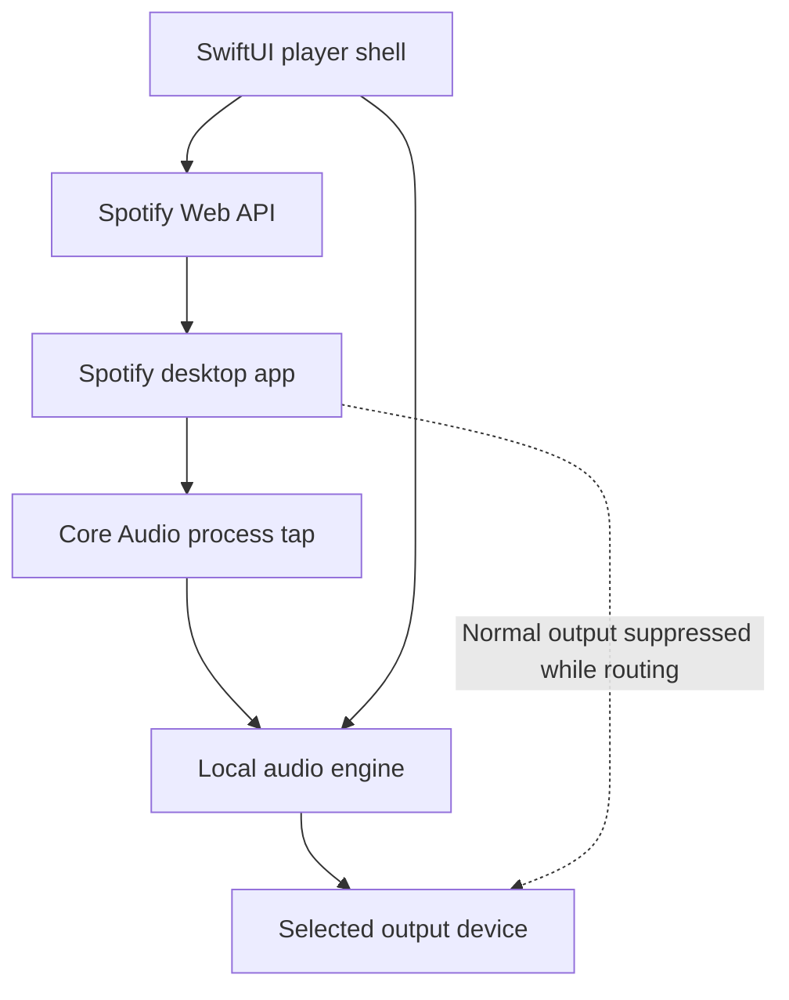

Draft technical design · 6 November 2026

Build a native macOS shell that controls the installed Spotify desktop application and routes its audio through a local playback engine. Spotify remains responsible for account access, streaming, decoding and track playback. The shell owns the interface, audio routing and output selection.

The proposed implementation is a normal Swift application using Core Audio process taps. It requires no separately installed audio driver. Compatibility with Spotify capture and source muting must pass an initial prototype gate before the full interface is built.

# Scope and platform

The first release targets personal use on macOS 14.4 or later, initially on Apple silicon. This is a conservative product baseline, not a claim that all tap APIs first appeared in 14.4. Verify API availability against the chosen Xcode SDK. Intel support is a separate validation target.

Prerequisites are an installed and signed-in Spotify desktop app, a Premium account, a Spotify developer application with access to the required Player API endpoints, and macOS system audio recording permission.

The MVP includes play, pause, previous, next, seek, now-playing metadata, a local output volume control, output-device selection, routing status and a switch back to ordinary Spotify playback. Start with stereo passthrough. Recording, offline playback, audio export, remote rebroadcasting, DSP effects, a replacement Spotify decoder and a full playlist browser are outside the MVP.

Spotify API access is a release dependency. Current development-mode limits constrain personal testing and authorized users; do not assume a public release is available through the same registration. See [Spotify quota modes](https://developer.spotify.com/documentation/web-api/concepts/quota-modes).

# Architecture

The control path and audio path are independent. An API command changes Spotify playback; it does not deliver audio to the shell.

Use the Spotify Web API rather than the Web Playback SDK. The desktop app is the playback source, so no embedded browser player is needed. A process tap captures outgoing process audio independently of unrelated applications. It does not reach inside Spotify before its own normalization, EQ, volume processing or decoding. Do not promise bit-perfect recovery of the source recording.

Apple documents process capture and aggregate-device integration in [Capturing system audio with Core Audio taps](https://developer.apple.com/documentation/coreaudio/capturing-system-audio-with-core-audio-taps).

# Component responsibilities

| Component | Responsibility |
| - | - |
| PlayerViewModel | UI state and user intents on the main actor |
| SpotifyAuth | PKCE login, token refresh and Keychain storage |
| SpotifyClient | Typed Player API requests, error handling and playback reconciliation |
| SourceResolver | Discover Spotify audio-producing processes and track their lifetimes |
| AudioRouteController | Serialize creation, reconfiguration and teardown of the audio route |
| ProcessTapSession | Own tap, private aggregate device, property listeners and audio callbacks |
| AudioRenderer | Buffer management, format conversion when required, gain and output |
| Diagnostics | Bounded counters and redacted logs, with no retained audio |

Keep network calls and UI work outside real-time audio callbacks. Separate the Core Audio implementation from the SwiftUI layer behind small interfaces so synthetic test sources can replace Spotify.

# Spotify authentication and control

Use Authorization Code with PKCE in the system browser. A desktop app cannot safely retain a client secret. Generate a fresh verifier and state for every login, verify the callback state, exchange the code, and store refresh credentials in Keychain. Keep access tokens out of logs and preferences.

Use a registered explicit loopback callback such as [http://127.0.0.1\:PORT/callback](http://127.0.0.1\:PORT/callback), following Spotify's matching and port rules. Bind the callback listener only to loopback and close it after completion or timeout. See [PKCE](https://developer.spotify.com/documentation/web-api/tutorials/code-pkce-flow) and [redirect URI requirements](https://developer.spotify.com/documentation/web-api/concepts/redirect_uri).

Request user-read-playback-state and user-modify-playback-state. Add user-read-currently-playing only if that endpoint is used. Do not request the streaming scope for this desktop-control architecture.

| Operation | Player API |
| - | - |
| Discover devices | GET /v1/me/player/devices |
| Read playback state | GET /v1/me/player |
| Transfer playback to selected computer | PUT /v1/me/player |
| Resume or pause | PUT /v1/me/player/play or /pause |
| Next or previous | POST /v1/me/player/next or /previous |
| Seek | PUT /v1/me/player/seek |

Recheck these endpoints against the registered app's actual access before implementation. Spotify Connect device IDs are not macOS PIDs. Have the user identify the local Spotify device; do not infer a trustworthy mapping from the device name alone. Refresh devices when an ID becomes stale.

Serialize transport commands and reconcile their result with observed playback state. A successful HTTP response does not prove that local audio has started. Poll conservatively, interpolate the progress display locally, reduce polling while idle, and respect Retry-After on HTTP 429. Refresh once on 401; surface authorization or access failures on 403. Avoid automatically retrying next/previous after an ambiguous timeout because that could skip twice.

The local shell volume changes renderer gain. Keep Spotify's source volume unchanged by default; distinguish source volume from shell volume if both are later exposed.

# Core Audio capture and rendering

Resolve the audio-producing Spotify process or processes to Core Audio process object IDs. Do not pass raw operating-system PIDs where the API requires AudioObjectID values. Spotify may use helper processes; verify the real source empirically and refresh the capture set after restarts. Capture only that allowlist.

Create a CATapDescription and a process tap using AudioHardwareCreateProcessTap. Obtain the actual tap format. Attach the tap to a private aggregate device and create the I/O callback needed to receive samples. These are runtime Core Audio objects owned by the app, not a driver installation or a device the user must configure manually.

For the first prototype, prefer an aggregate configuration containing the tap and selected output device so capture and rendering can share a coherent device clock. Validate channel and stream mapping on real hardware. If separate capture and output callbacks are necessary, use a preallocated single-producer/single-consumer ring buffer and explicit clock-drift management. A queue alone cannot absorb clock mismatch indefinitely.

Use the negotiated sample rate and channel layout. Start with Float32 stereo internally, converting explicitly at boundaries when required. Select and test a clock source; use supported drift compensation or adaptive resampling where clocks differ. Do not silently assume that capture and output are both 48 kHz.

The real-time callback may copy samples, apply bounded processing and update lock-free counters. It must not allocate memory, acquire blocking locks, perform network or disk I/O, emit ordinary logs, or call into the UI. Preallocate buffers, conversion state and any processing state before starting.

On underrun, render silence and increment a counter. On overrun, discard according to a bounded policy and reset alignment rather than allowing latency to grow indefinitely. Fade transitions where practical to avoid clicks. Never replay stale buffered samples after a seek, source restart or output-device rebuild.

# Muting and route lifecycle

Use the tap's mutedWhenTapped behavior to suppress the captured source's direct playback while the tap is being consumed. Do not achieve this by setting Spotify's volume to zero, which may also silence the captured samples. Apple exposes this through [CATapMuteBehavior](https://developer.apple.com/documentation/coreaudio/catapmutebehavior). Confirm the exact mute scope and cleanup behavior with Spotify on every supported macOS version.

The route lifecycle is Idle, Preparing, Running, Reconfiguring, Stopping or Failed. Authentication and Spotify transport state are tracked separately.

Start routing in this order:

1. Resolve the source process set and selected physical output.

2. Obtain capture permission and verify nonzero samples during known playback.

3. Allocate the renderer, callback storage and conversion resources.

4. Create and start the final route with conditional source muting.

5. Confirm advancing callbacks and healthy buffers before showing Routing active.

Avoid prolonged overlap between direct and captured playback. The transition must be measured for duplicate audio, silence and clicks.

Stopping reverses ownership: stop I/O, release callbacks and listeners, destroy the aggregate device and tap, clear buffers, and restore ordinary source output. Cleanup is idempotent after a partial start. Verify normal quit and forced termination; do not assume conditional muting alone proves crash recovery.

Exclude the shell's own process from capture. Never fall back to capturing the entire system if Spotify process resolution fails.

# Failure and recovery

| Event | Required behavior |
| - | - |
| Capture permission denied | Explain how to grant access; retain Spotify controls without routing |
| Spotify stops or restarts | Stop stale capture, rediscover process IDs and offer or perform configured reconnection |
| Remote Spotify device becomes active | Show playback elsewhere; stop representing local capture as active |
| Output unplugged | Stop routing and surface device loss; do not unexpectedly switch headphones to speakers |
| Sleep and wake | Revalidate devices and processes and rebuild the route |
| Sample rate or device configuration changes | Stop callbacks safely and renegotiate formats |
| Token expires | Refresh without disturbing an otherwise healthy audio route |
| API unavailable | Mark metadata stale; do not claim a failed pause or seek succeeded |
| Capture remains silent while Spotify reports playing | Diagnose process selection, permission and device routing; silence alone is not definitive failure |
| Renderer fails | Tear down capture and show that normal Spotify output may resume |

The default device-loss behavior prioritizes preventing unexpected speaker playback. Best-effort pause Spotify before releasing a muted route when output disappears; network failure means this cannot be guaranteed. Make that limitation explicit in implementation tests. Do not change the global default output device as a recovery shortcut.

# Packaging and security

Ship a signed and notarized .app for direct distribution. No privileged helper or kernel extension is planned. Treat Mac App Store distribution and App Sandbox compatibility as separate investigations, not MVP assumptions.

Add NSAudioCaptureUsageDescription with a clear explanation that Spotify audio is routed through the app. The system requests audio capture permission when recording from an aggregate device containing a tap begins. Microphone recording is not a product requirement.

Keep PCM in bounded memory buffers and discard it after playback. Diagnostic exports contain device formats, timestamps, OSStatus errors, buffer counters and route transitions, never tokens or audio. Use stable output-device UIDs for preferences; do not persist transient AudioObjectIDs or PIDs.

Technical feasibility does not establish Spotify authorization for distribution or audio modification. Spotify's published developer restrictions affect commercial streaming integrations and altered content. Resolve the intended release and processing scope against the [Developer Policy](https://developer.spotify.com/policy) before expanding beyond the personal passthrough prototype.

# Validation and acceptance

The first milestone is an audio feasibility experiment, before OAuth or a polished UI. Play Spotify manually, isolate its process audio, route it to wired headphones, and verify source suppression. If current Spotify or macOS behavior prevents capture, stop and reassess the architecture rather than building around an assumption.

| Test | Acceptance |
| - | - |
| Source isolation | Spotify is audible in capture; concurrent notification and browser audio are absent |
| Direct-output suppression | Exactly one audible Spotify path while routing; direct playback returns after stop |
| Normal quit and forced termination | No persistent silent source or abandoned route requiring a reboot |
| Format handling | Verified 44.1 and 48 kHz stereo operation without speed or pitch errors |
| Stability | One-hour wired playback run without application-buffer underruns, overruns or growing delay |
| Device lifecycle | Repeated unplug, reconnect and sleep/wake cycles recover without crash or feedback |
| Seeking and track changes | No stale queued audio after reconciliation |
| API failure | Expired tokens, rate limits and ambiguous transport responses produce truthful UI state |
| Privacy | No tokens or audio in logs or diagnostic exports |

Use synthetic tones and impulses from a test app for objective level, channel, latency and drift measurements. Then test the real Spotify integration separately. Capture isolation is not evidence of bit-perfect playback.

Proposed performance target: less than 50 ms added latency on a supported wired output under ordinary load, measured against the same direct-output path. This is a target to validate, not a guarantee. Bluetooth latency is device-dependent and should be reported separately.

Record results by macOS version, processor architecture, Spotify version, output device and audio format. Test normalization, EQ and source-volume settings to characterize which processing is already present at the tap.

# Implementation sequence

1. **Audio feasibility:** Small native harness for process discovery, tap creation, source muting and wired passthrough. Exit only when isolation, muting and teardown tests pass.

2. **Reliable audio engine:** Add buffer instrumentation, format negotiation, device listeners, sleep/wake handling and failure recovery.

3. **Spotify control:** Implement PKCE, Keychain, local-device selection, serialized transport commands and state reconciliation.

4. **Player shell:** Add now-playing UI, transport, seek, local volume, output selector and clearly separate source and routing status.

5. **Distribution readiness:** Validate signed builds on clean Macs, permission flows, policy scope and supported-device coverage.

A minimal prototype is plausibly a few days of work for an experienced macOS audio developer. A reliable application is a multiweek project; supported device combinations and recovery behavior will dominate the effort.

Open implementation decisions are the final aggregate-device topology, exact source process set, validated minimum macOS version, Intel support, acceptable measured latency and whether any future DSP scope is permitted. Resolve these through the prototype and product requirements before committing to a release date.
